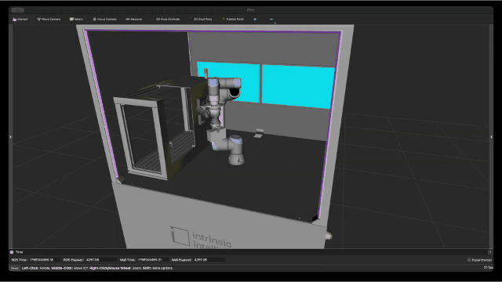
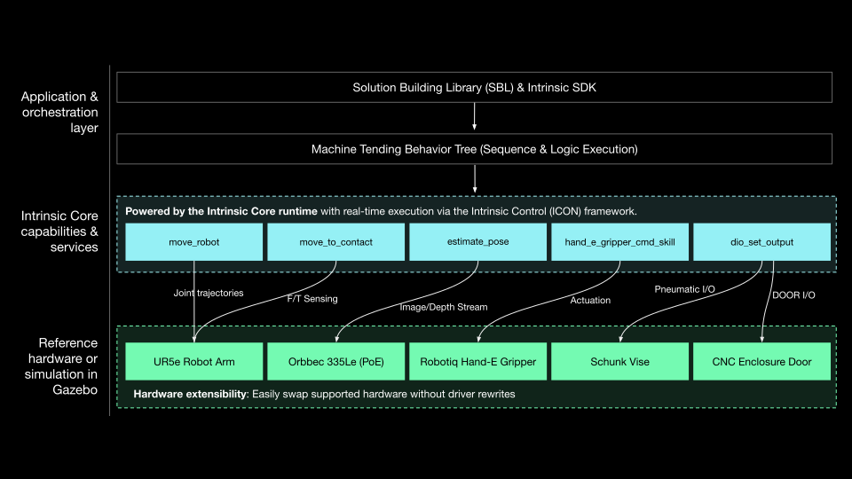
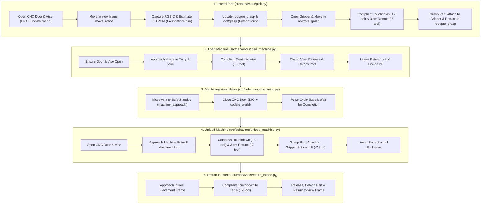

# Open Machine Tending Solution (OMTS)

[](https://github.com/intrinsic-ai/intrinsic-omts/actions/workflows/ci.yml) [](https://github.com/intrinsic-ai/intrinsic-omts/actions/workflows/ci.yml) [](https://www.python.org/) [](LICENSE) [](https://developer.intrinsic.ai) [](https://www.ros.org/) [](.github/workflows/dependabot.yml)

The Open Machine Tending Solution (OMTS) is an open-source reference application for automated machine tending built on [Intrinsic Core™](https://github.com/intrinsic-ai/intrinsic-core) and compatible with ROS to jump-start the development of industrial applications.

<p align="center">
  
</p>

- A functional baseline for a real-world machine shop use case that delivers pre-configured assets, skills, a native digital twin ready to use out of the box.
- Easily customize solutions with hardware-agnostic robot control, making it easy to swap arms, grippers, and sensors without rewriting application code.
- Built-in compatibility with NVIDIA FoundationPose®, providing accurate 6-DoF pose estimation of parts without custom vision pipeline wrappers.
- An open, modular template built for seamless customization across adjacent manufacturing tasks and collaborative open-source contribution.

---

## Installation and setup

See the [Getting Started guide](https://github.com/intrinsic-ai/intrinsic-core/tree/main/developer_resources/learn/tutorials/getting_started.md) for full installation and setup instructions.

---

## High level OMTS architecture

<p align="center">
  
</p>

See [Architecture.md](docs/ARCHITECTURE.md) for more details.

### Components represented in the architecture

#### Behavior tree
The top-level task orchestration engine. Built using the Solution Building Library (SBL), it executes modular behavior trees to coordinate skills, logic branching, and error handling. By decoupling high-level sequence coordination from underlying motion and perception algorithms, it allows developers to modify process logic and recovery routines without touching low-level driver or controller code.

#### Skills and services
- **`move_robot`**: Encapsulates constraint-aware motion planning and real-time control to automatically generate collision-free paths and stream optimized trajectories directly to the robot controller, ensuring smooth, deterministic execution without manual waypoint engineering.
- **`move_to_contact`**: Leverages real-time force/torque feedback to drive compliant, guarded approach motions, automatically arresting or adapting trajectory upon physical contact to ensure safe, damage-free part localization and seating.
- **`estimate_pose`**: Executes GPU-accelerated 6-DoF pose estimation via NVIDIA FoundationPose® to determine accurate workpiece position and orientation directly from camera feeds, enabling robust grasp planning without rigid physical fixturing.
- **`hand_e_gripper_cmd_skill`**: Skill to control the Robotiq Hand-E gripper.
- **`dio_set_output`**: Toggles digital outputs on the I/O controller to automate external hardware signals, such as commanding the CNC machine door to open/close and actuating the vise clamp.

---

## Documentation and resources

- [Architecture & System Design](https://github.com/intrinsic-ai/intrinsic-omts/blob/main/docs/ARCHITECTURE.md): SBL abstractions, behavior tree lifecycle, infeed strategy pattern, and domain models.
- [Extending Hardware & Real I/O](src/hardware/README.md): Guide for connecting real Robotiq grippers, pneumatic vises, CNC machine door interlocks, and 3D perception tracking.
- [Developer Playbook & Operations](tools/README.md): Bazel execution, unit tests, diagnostic tools (`inspect_world`, `apply_scene_updates`, `move_to_frame`), and troubleshooting gotchas.
- [Tutorials](https://github.com/intrinsic-ai/intrinsic-core/tree/main/developer_resources/learn/tutorials): Step-by-step guides to get started, customize physical layouts, visualize the robot, and more.
- [Glossary](https://github.com/intrinsic-ai/intrinsic-core/blob/main/developer_resources/learn/glossary/general_terms.md): Technical definitions of Intrinsic Core and OMTS.
- [Intrinsic developer community](https://developer.intrinsic.ai/): Guides, tutorials, a community forum to ask questions, share projects, and get support, and be the first to hear about new tools and features.

---

## Implementation details

### 1. Solution architecture and execution pipeline

OMTS orchestrates a complete perception-to-manipulation machine tending cycle inside a single SBL `BehaviorTree` wrapped in `bt.Loop` for single-cycle, multi-cycle, or continuous operation. It features a dual-infeed strategy supporting either Vision-Guided Pick (random part placement via 3D camera pose estimation) or Blind Grid Pick (deterministic pallet slot math):



### 2. Architecture and SBL abstractions

OMTS adheres to clean separation of concerns:

- **Domain Models ([`src/core/`](src/core/))**: Represents manufacturing state (`Workpiece`, `PartState`, `TraySlot`, `WorkcellState`) independently from robot kinematics.
- **Hardware Adapters ([`src/hardware/`](src/hardware/))**: Stateless adapters that build SBL skill tasks. `Robot` is a single class for any ICON-controlled arm because the motion and attachment skills it wraps are vendor-neutral; grippers, the CNC machine, and the camera have interfaces with device-specific implementations.
- **Infeed Strategy Pattern ([`src/core/infeed.py`](src/core/infeed.py))**: Encapsulates part acquisition logic:
  - `PerceptionInfeed`: Uses camera + pose estimation for unstructured / random part placement.
  - `GridInfeed`: Uses mathematical row/column indexing for structured tray pallets.
- **Composable Behavior Trees ([`src/behaviors/`](src/behaviors/))**: Modular factory functions returning standard `bt.Node` / `bt.SubTree` building blocks.

### 3. Prerequisites and workspace setup

#### Hardware requirements

- **CPU**: x86-64 architecture (ARM architectures are currently unsupported).
- **GPU**: Integrated graphics minimum (dedicated NVIDIA RTX 3060/4060+ strongly
  recommended for ML/vision workloads).
- **RAM**: 32 GiB DDR4/DDR5 minimum (64 GiB recommended). Note: Build times may
  be impacted if attempting to compile changes at minimum specs while having a
  solution actively running.
- **Storage**: 1 TB NVMe SSD (minimum 100 GB dedicated free space).
- **Networking**: 2–3 Gigabit Ethernet ports (Port 1: LAN/Internet; Port 2:
  Real-time Robot Controller; Optional Port 3: PoE Camera switch).

#### GitHub release artifacts

During the build, Bazel automatically downloads the following prebuilt bundles
and model weights from this repository's GitHub Releases (configured in
[`MODULE.bazel`](MODULE.bazel)):

- `flowstate_ros_bridge.bundle.tar`: Prebuilt service of
  [`flowstate_ros_bridge`](https://github.com/intrinsic-ai/sdk-ros/tree/main/flowstate_ros_bridge).
- `hand_e_gripper_service.bundle.tar`: Prebuilt Robotiq Hand-E ROS driver
  service.
- `hand_e_gripper_cmd_skill.bundle.tar`: Prebuilt Robotiq Hand-E control skill.
- `orbbec_gemini_driver.bundle.tar`: Prebuilt driver service of
  [`flowstate_orbbec`](https://github.com/intrinsic-ai/intrinsic-ros-camera-drivers/tree/main/flowstate_orbbec).
- `moveit_plan_grasp_skill.bundle.tar`: Prebuilt MoveIt grasp planning skill
  (`ai.intrinsic.moveit_plan_grasp_skill`). It is installed into every solution
  so that `--grasp_planner=moveit` works without sideloading, but it only
  executes once you have stood up the MoveIt planning service — see
  [§8 Optional integrations](#8-optional-integrations).

### 4. Build and run instructions

#### 4.1. Build and install NVIDIA Pose Estimator model `DataAssets` (one-time per cluster)

The three perception model `DataAssets` (`foundationpose_models`,
`foundationstereo_models`, and `sam3_models`) are tagged `manual` in
`@intrinsic-core` and are not built by `//:omts_solution`. Build and install
them onto the cluster **before** deploying `//:omts_solution` so that
`nvidia_pose_estimator_service` resolves them when its instance is created (see
the
[`nvidia_pose_estimator` README in `intrinsic-core`](https://github.com/intrinsic-ai/intrinsic-core/blob/main/intrinsic_perception/intrinsic/perception/service/nvidia_pose_estimator/README.md)
for architecture, TensorRT engine caching, and licensing details):

```bash
# 1. Accept the Meta SAM License on https://huggingface.co/facebook/sam3,
#    authenticate (`hf auth login`), and export the SAM 3 ONNX weights:
bazel fetch @intrinsic-core//intrinsic_perception/intrinsic/perception/service/nvidia_pose_estimator:sam3_model_data_asset
"$(bazel info output_base)/external/intrinsic-core+/intrinsic_perception/intrinsic/perception/service/nvidia_pose_estimator/scripts/prepare_sam3_models.sh" \
  --output-dir "${HOME}/.cache/intrinsic/nvidia_pose_estimator_models"

# 2. Build the three model DataAsset bundles (.bazelrc already sets
#    build_full_image=True and download_weights=True):
bazel build \
  --repo_env=NVIDIA_POSE_ESTIMATOR_MODELS_DIR="${HOME}/.cache/intrinsic/nvidia_pose_estimator_models" \
  @intrinsic-core//intrinsic_perception/intrinsic/perception/service/nvidia_pose_estimator:foundationpose_model_data_asset \
  @intrinsic-core//intrinsic_perception/intrinsic_perception/service/nvidia_pose_estimator:foundationstereo_model_data_asset \
  @intrinsic-core//intrinsic_perception/intrinsic/perception/service/nvidia_pose_estimator:sam3_model_data_asset

# 3. Install the three model DataAssets onto the cluster:
inctl asset install --address=localhost:17080 \
  bazel-bin/external/intrinsic-core+/intrinsic_perception/intrinsic/perception/service/nvidia_pose_estimator/foundationpose_model_data_asset.bundle.tar
inctl asset install --address=localhost:17080 \
  bazel-bin/external/intrinsic-core+/intrinsic_perception/intrinsic/perception/service/nvidia_pose_estimator/foundationstereo_model_data_asset.bundle.tar
inctl asset install --address=localhost:17080 \
  bazel-bin/external/intrinsic-core+/intrinsic_perception/intrinsic/perception/service/nvidia_pose_estimator/sam3_model_data_asset.bundle.tar
```

> [!NOTE]
> If `//:omts_solution` was already deployed before installing or updating the
> model `DataAssets`, recreate the service instance so it binds the newly
> installed assets:
> ```bash
> inctl service delete --address=localhost:17080 nvidia_pose_estimator_service || true
> inctl service add --address=localhost:17080 ai.intrinsic.nvidia_pose_estimator_service
> ```

#### 4.2. Deploy the workcell solution

Build and launch the ICON controller, hardware modules, perception services, and
simulator. By default, `//:omts_solution` deploys in `real` mode
(`default_operation_mode = "real"` in [`BUILD`](BUILD)). Pass
`--operation_mode=sim` after `--` to run in simulation (Gazebo physics and
simulated 3D camera renders):

```bash
# Deploy default OMTS cell (UR5e + CNC enclosure + Schunk vise) in simulation:
bazel run //:omts_solution -c opt -- \
  --address=localhost:17080 \
  --operation_mode=sim

# Deploy Lab BB-01 cell (UR3e + CAW enclosure, no CNC machine) in simulation:
bazel run //:omts_solution -c opt --//:setup=lab_bb_01 -- \
  --address=localhost:17080 \
  --operation_mode=sim

# Deploy on physical hardware (defaults to --operation_mode=real):
bazel run //:omts_solution -c opt -- --address=localhost:17080
bazel run //:omts_solution -c opt --//:setup=lab_bb_01 -- --address=localhost:17080
```

> [!NOTE]
> Deploying without `--operation_mode=sim` starts the solution in `real` mode,
> where ICON requires a real-time kernel and physical robot connection (failing
> with `no healthy upstream` otherwise) and Gazebo runs as a no-op stub. When
> switching a running cluster between `real` and `sim`, stop the active solution
> first (`inctl solution stop --address=localhost:17080`).

#### 4.3. Register and verify workpiece pose estimator (required before running `omts_app`)

Register and optionally verify the OMTS workpiece pose estimator using the CLI
tools from `@intrinsic-core`:

```bash
# Register the text-prompted pose estimator for the raw stock workpiece:
bazel run @intrinsic-core//intrinsic_perception/intrinsic/perception/service/ioc_train_service/tools:register_using_ioc_train_service -- \
  --address="localhost:17080" \
  --scene_object_id="ai.intrinsic.raw_stock_2x3x5" \
  --pose_estimator_id="ai.intrinsic.raw_stock_2x3x5_estimator_text" \
  --refinement_iters=5 \
  --confidence_threshold=0.15 \
  --visibility_threshold=0.15 \
  --text_prompt="cuboid"

# Optionally verify pose detection directly against the live camera feed:
bazel run @intrinsic-core//intrinsic_perception/intrinsic/perception/service/ioc_pose_estimator:run_pose_estimation -- \
  --address="localhost:17080" \
  --service_name="nvidia_pose_estimator_service" \
  --camera_name="orbbec_camera" \
  --pose_estimator_id="ai.intrinsic.raw_stock_2x3x5_estimator_text"
```

#### 4.4. Run the OMTS application

Connect to the running deployment and execute the machine tending Behavior Tree:

```bash
# Run with default OMTS cell configuration:
bazel run //src:omts_app -- \
  --address=localhost:17080 \
  --config="configs/omts/app_config.yaml"

# Run with Lab BB-01 cell configuration:
bazel run //src:omts_app -- \
  --address=localhost:17080 \
  --config="configs/lab_bb_01/app_config.yaml"

# Override cycle count (e.g. 3 cycles, or 0 for continuous loop) and execution mode:
bazel run //src:omts_app -- \
  --address=localhost:17080 \
  --config="configs/omts/app_config.yaml" \
  --num_cycles=3 \
  --simulation_mode=fast_preview

# Optionally, plan the infeed grasp with MoveIt instead of the built-in cuboid-center
# heuristic (requires the MoveIt planning service, see §8):
bazel run //src:omts_app -- \
  --address=localhost:17080 \
  --config="configs/omts/app_config.yaml" \
  --grasp_planner=moveit
```

> [!TIP]
> `--simulation_mode` on `//src:omts_app` controls the SBL Executive preview
> mode (`reality`, `preview`, `fast_preview`), not the cluster deployment mode.
> When the solution is deployed with `--operation_mode=sim`, leave
> `--simulation_mode` at its default (`reality`) so the Behavior Tree executes
> against Gazebo and the simulated camera; use `preview` or `fast_preview` only
> for kinematic trajectory previews in the Belief World without stepping Gazebo.

The grasp planner defaults to `cuboid_center`, which derives a top-down grasp
from the pose estimate and needs no extra services. `--grasp_planner` overrides
the `grasp.planner` field in `app_config.yaml` for a single run; set that field
instead to make the choice permanent for a cell. The `grasp.moveit_*` config
fields (planning group, candidate surfaces, retract distance, timeout) only
apply to the `moveit` backend.

### 5. Testing and developer tools

#### Unit tests

Run the hermetic unit test suite offline (no running cluster or physical
hardware required):

```bash
bazel test //tests/...
```

#### Operational and diagnostic CLI tools

See [`tools/README.md`](tools/README.md) for the full reference. Common commands:

```bash
# Inspect live world kinematic tree, frames, and joint states:
bazel run //tools/world:inspect_world -- --address=localhost:17080

# Interactive robot jogging:
bazel run //tools/jogging:jog_interactive -- --instance=icon --host=localhost --port=17080

# Move robot tool to a named scene frame:
bazel run //tools/jogging:move_to_frame -- --address=localhost:17080 --frame=view --motion_type=ANY

# Teach & persist current tool pose to scene.updates.pbtxt:
bazel run //tools/jogging:store_frame -- view --address=localhost:17080

# Control gripper (Robotiq or DIO):
bazel run //tools/gripper:control_gripper -- --address=localhost:17080 --action=open

# Control CNC machine doors, vise, and cycle signals:
bazel run //tools/machine:control_machine -- --address=localhost:17080 --action=open_door
```

### 6. Code quality and formatting

OMTS enforces formatting and linting checks on all pull requests via GitHub
Actions CI (`line-length = 80`, `indent-width = 2`):

```bash
# Auto-format Bazel (buildifier) and Python/Markdown (ruff) files:
./tools/format.sh

# Run CI lint and format verification checks locally:
./tools/lint.sh
```

### 7. Licensing information for NVIDIA FoundationPose®

OMTS uses **NVIDIA FoundationPose®**, **NVIDIA FoundationStereo**, and **Meta
SAM 3** via `nvidia_pose_estimator_service` from
[Intrinsic Core](https://github.com/intrinsic-ai/intrinsic-core) for RGB-D 6-DoF
pose estimation. Model weights for FoundationPose and FoundationStereo (governed
by the
[NVIDIA Open Model License](https://www.nvidia.com/en-us/agreements/enterprise-software/nvidia-open-model-license/))
and SAM 3 (governed by the
[Meta SAM License](https://huggingface.co/facebook/sam3)) are not distributed in
this repository; they are fetched or exported directly from their respective
providers when building the perception model `DataAssets`. See the upstream
[`nvidia_pose_estimator` README in `intrinsic-core`](https://github.com/intrinsic-ai/intrinsic-core/blob/main/intrinsic_perception/intrinsic/perception/service/nvidia_pose_estimator/README.md)
for full build and licensing details.

---

## 8. Optional integrations

MoveIt grasp planning is an opt-in alternative to the built-in cuboid-center
heuristic. The integration code is third-party and lives under
[`third_party/intrinsic_moveit/`](third_party/intrinsic_moveit/README.md); it is
reachable two ways:

- **From the main application**: `bazel run //src:omts_app -- --grasp_planner=moveit`
  (or `grasp: {planner: "moveit"}` in `app_config.yaml`). Perception still
  localizes the workpiece, but MoveIt plans the grasp on it.
- **Standalone**: the `moveit_plan_grasp_and_move` CLI tool, for bringing the
  integration up and debugging candidates outside a production cycle.

> [!NOTE]
> Until you have completed the [intrinsic-moveit](https://github.com/intrinsic-ai/intrinsic-moveit)
> integration against your solution, `--grasp_planner=moveit` will fail at
> runtime and the standalone tools will do nothing. The default
> `--grasp_planner=cuboid_center` path is unaffected. See
> [`third_party/intrinsic_moveit/README.md`](third_party/intrinsic_moveit/README.md)
> for the prerequisites and the tool reference.

---

## Contributing and community

Contributions are welcome! Please review:

* [CONTRIBUTING.md](CONTRIBUTING.md): Details on signing the Google Contributor License Agreement (CLA), community guidelines, C++20 coding standards, and pull request workflows.
* [SECURITY.md](SECURITY.md): Instructions for reporting security vulnerabilities.

---

## License

This project is licensed under the [Apache 2.0 License](LICENSE).

---

**Disclaimer**: This is not an officially supported Google product.

---

### Trademark notice

"Intrinsic" and "Intrinsic Core" are trademarks of Intrinsic Innovation LLC. See [TRADEMARK.md](TRADEMARK.md) for usage guidelines.
