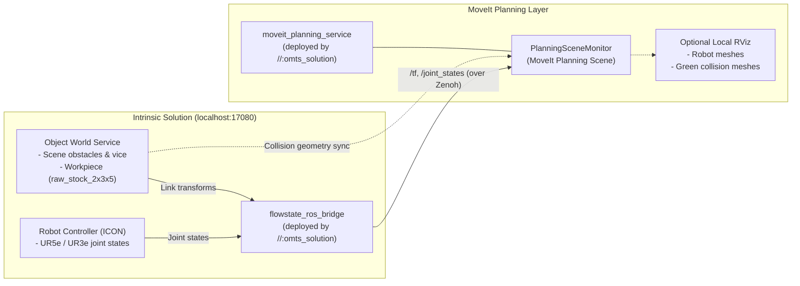
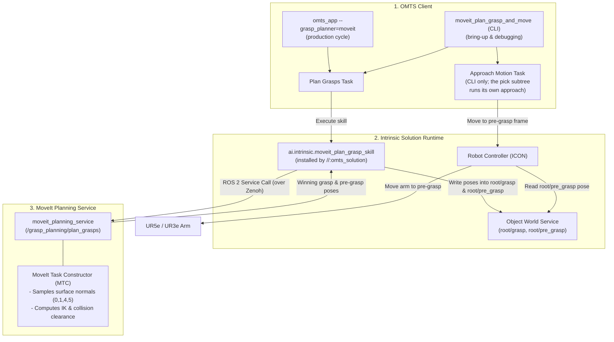

# MoveIt Grasp Planning (third-party integration)

Model-based grasp planning for OMTS, backed by
[`intrinsic-ai/intrinsic-moveit`](https://github.com/intrinsic-ai/intrinsic-moveit)
and MoveIt Task Constructor. Given a part in the Object World, the planning
service enumerates grasp candidates over the part's surfaces, ranks them, and
writes the winner's grasp and pre-grasp poses back into the world. A dedicated
CLI tool drives it for scene bring-up and verification.

This is the `moveit` backend of the OMTS grasp planner selection. Choose it with
`bazel run //src:omts_app -- --grasp_planner=moveit`, or permanently per cell
with `grasp: {planner: "moveit"}` in `app_config.yaml`. Both OMTS workcell
configurations are supported (`omts` by default, and `lab_bb_01` starting in
`intrinsic-moveit` `v0.1.0`). The default grasp planner backend remains the
built-in `cuboid_center` heuristic, which needs none of this.

> [!NOTE]
> `//:omts_solution` automatically installs and starts both
> `ai.intrinsic.moveit_planning_service` and
> `ai.intrinsic.moveit_plan_grasp_skill` for the selected `--//:setup` (`omts`
> or `lab_bb_01`), so `--grasp_planner=moveit` and `moveit_plan_grasp_and_move`
> work directly against a deployed solution without manual sideloading or a
> local ROS 2 workspace. See
> [Deployment, RViz Visualization & Source Development](#deployment-rviz-visualization--source-development)
> to inspect the live MoveIt planning scene in RViz or run the planning service
> from source during development.

The planning code here is third-party and deliberately namespaced: everything is
named `moveit_*` so that it never has to be told apart from the built-in
planner by context.

---

## Architecture

The integration connects OMTS behavior orchestration to MoveIt 2 and MoveIt Task Constructor (MTC). To keep components simple and decoupled, the architecture is divided into two distinct flows:
1. **Planning Scene Synchronization**: How the robot state and world objects are streamed into MoveIt in real time.
2. **Grasp Planning & Execution**: How OMTS requests grasps, updates the world, and executes approach motions.

### 1. Planning Scene Synchronization

MoveIt needs an accurate, live view of the robot and surrounding obstacles. The `flowstate_ros_bridge` continuously streams robot joint states and transform frames, while collision geometries from the Object World Service are synchronized into MoveIt's `PlanningSceneMonitor`.



- **Robot Transforms & Joints**: `flowstate_ros_bridge` streams `/tf` and `/joint_states` to ROS 2 over Zenoh. Its default config, as deployed by `//:omts_solution`, is sufficient; MoveIt matches joint states by name, so no bridge reconfiguration is needed.
- **Collision Objects**: Object geometries from the Object World Service (such as tables, the CNC vice, and workpieces) are converted into MoveIt collision objects and displayed as green meshes in RViz.

---

### 2. Grasp Planning & Approach Execution

When planning a grasp, OMTS does not directly move the robot through MoveIt. Instead, it runs a two-step Behavior Tree:
1. **Plan Grasps**: Call the planning service via `ai.intrinsic.moveit_plan_grasp_skill` and save the resulting poses to the Object World Service (`root/grasp` and `root/pre_grasp`).
2. **Approach Pre-Grasp**: Move the arm to the pre-grasp pose using native OMTS Cartesian motion primitives.



- **Decoupled Hand-off**: The planning skill only updates poses in the Object World; it never commands motors directly.
- **Native OMTS Motion**: The arm motion uses first-party OMTS Cartesian moves ([`create_move_to_frame_task`](../../src/behaviors/motions.py)), keeping first-party OMTS independent of ROS 2.

---

## Layout

| Path | Role |
| :--- | :--- |
| [`moveit_grasp_planner.py`](./moveit_grasp_planner.py) | `MoveItGraspPlannerInterface` (implements the first-party [`GraspPlannerInterface`](../../src/hardware/grasping.py)) and its `MoveItGraspPlanner` / `MockMoveItGraspPlanner` implementations; surface constants. |
| [`moveit_grasp_planning.py`](./moveit_grasp_planning.py) | `build_moveit_grasp_planning_subtree` — plan a grasp, then approach the resulting pre-grasp. |
| [`tools/moveit_plan_grasp_and_move.py`](./tools/moveit_plan_grasp_and_move.py) | CLI tool to plan a grasp on target workpiece(s) and move the arm to pre-grasp. |
| [`tests/`](./tests/) | Offline unit tests for grasp planning subtree and CLI argument parsing. |

This package depends on three first-party targets: `//src/hardware:grasping`
(the `GraspPlannerInterface` contract it implements), `//src/hardware:robot`
(for `RobotInterface` and `UrRobot`), and `//src/behaviors:motions` (for the
approach move), plus `//src/utils:script_utils` for the settle dwell.

In the other direction, exactly one first-party target reaches in here:
[`//src/hardware:grasp_planners`](../../src/hardware/grasp_planners.py), the
factory that maps `GraspPlannerType.MOVEIT` to a `MoveItGraspPlanner`. Nothing
else first-party imports this package, so `--grasp_planner=cuboid_center` never
touches any of it.

---

## Deployment, RViz Visualization & Source Development

`//:omts_solution` downloads both `moveit_planning_service.bundle.tar` and
`moveit_plan_grasp_skill.bundle.tar` at build time (pinned to `v0.1.0` in
[`MODULE.bazel`](../../MODULE.bazel)) and deploys them automatically in the
cluster (`rs-moveit-planning-service-0` in `app-resources`):

- `--//:setup=omts` (default): runs `moveit_planning_service` with its default
  configuration (`robot_config: "omts"`, UR5e).
- `--//:setup=lab_bb_01` (`--config=lab_bb_01`): applies
  [`configs/lab_bb_01/moveit_planning_service_config.textproto`](../../configs/lab_bb_01/moveit_planning_service_config.textproto)
  (`robot_config: "lab_bb_01"`, UR3e).

Verify that the planning service pod is up with:

```bash
kubectl get pods -n app-resources
```

If you bump the `intrinsic-moveit` release pin in `MODULE.bazel`, redeploy
`//:omts_solution` rather than `inctl asset install`-ing by hand so the solution
and installed bundles stay in lockstep.

### 1. Optional: Visualize the MoveIt Planning Scene in RViz

You can attach a standalone local RViz window directly to the running in-cluster
`moveit_planning_service` pod without stopping or replacing the pod. Only the
hardware description and MoveIt config packages need to be built locally (to
provide the `package://` robot meshes and MoveIt/MTC RViz plugins; RViz receives
`/robot_description`, `/robot_description_semantic`, `/monitored_planning_scene`,
and MTC `/solution` directly from the cluster over Zenoh on port `7447`):

```bash
# One-time lightweight workspace setup (seconds to build; skips C++ sdk-ros/service build)
mkdir -p ~/ws_intrinsic_moveit/src && cd ~/ws_intrinsic_moveit/src
gh repo clone intrinsic-ai/intrinsic-moveit -- --revision=v0.1.0
source /opt/ros/lyrical/setup.bash
cd ~/ws_intrinsic_moveit
sudo apt update && sudo apt install -y \
  ros-lyrical-rmw-zenoh-cpp \
  ros-lyrical-moveit-ros-visualization \
  ros-lyrical-moveit-task-constructor-visualization
rosdep install --from-paths \
  src/intrinsic-moveit/robot_hardware_descriptions \
  src/intrinsic-moveit/third_party \
  --ignore-src -r -y
colcon build --symlink-install \
  --packages-up-to omts_moveit_config lab_bb_01_moveit_config
```

Then connect RViz to the cluster Zenoh router exposed on port `7447`:

```bash
source ~/ws_intrinsic_moveit/install/setup.bash
export RMW_IMPLEMENTATION=rmw_zenoh_cpp
export ZENOH_CONFIG_OVERRIDE='mode="client";connect/endpoints=["tcp/127.0.0.1:7447"]'

# Launch RViz for the default OMTS cell (UR5e):
ros2 launch omts_moveit_config moveit_rviz.launch.py \
  rviz_config:=$HOME/ws_intrinsic_moveit/src/intrinsic-moveit/moveit_planning_service/rviz/motion_planning_service.rviz

# Or, if //:omts_solution was deployed with --config=lab_bb_01 / --//:setup=lab_bb_01 (UR3e):
ros2 launch lab_bb_01_moveit_config moveit_rviz.launch.py \
  rviz_config:=$HOME/ws_intrinsic_moveit/src/intrinsic-moveit/moveit_planning_service/rviz/motion_planning_service.rviz
```

### 2. Verify Scene Synchronization in RViz

Once RViz opens, verify that:
- The robot is represented by its meshes (UR5e for `omts`, UR3e for `lab_bb_01`).
- All other objects in the scene are propagated as collision objects and represented as green meshes.

The state of the robot and objects are synchronized with the MoveIt planning scene. This can be verified with:

```bash
# Jogging the robot, see tutorial "Jog the robot"
bazel run //tools/jogging:jog_interactive -- \
  --host=localhost \
  --port=17080 \
  --instance=icon

# Updating the scene (OMTS cell only; lab_bb_01 has no CNC vise), see tutorial "Cell customization"
bazel run //tools/world:apply_scene_updates -- \
  --address localhost:17080 \
  --files configs/omts/raw_stock_in_vise.updates.pbtxt

# Resetting the scene, see tutorial "Cell customization"
inctl world reset --address localhost:17080
```

### 3. Optional: Build and Run `moveit_planning_service` from Source (Development)

When iterating on [`intrinsic-ai/intrinsic-moveit`](https://github.com/intrinsic-ai/intrinsic-moveit)
itself, build the full colcon workspace (including `lyrical.repos` dependencies)
and run `moveit_planning_service` locally from source instead of the in-cluster
pod:

```bash
# 1. Import source dependencies and build moveit_planning_service
cd ~/ws_intrinsic_moveit/src
source /opt/ros/lyrical/setup.bash
vcs import . < intrinsic-moveit/lyrical.repos --recursive
cd ~/ws_intrinsic_moveit
rosdep install --from-paths . --ignore-src -r -y
colcon build --cmake-args -DCMAKE_BUILD_TYPE=Release -DBUILD_TESTING=OFF \
  --symlink-install --packages-up-to moveit_planning_service
```

Before launching locally, stop the in-cluster `moveit_planning_service` instance
so two planning nodes do not compete on `/grasp_planning/plan_grasps` (or
comment out `":moveit_planning_service",` in `omts_solution.instances` in
[`BUILD`](../../BUILD) prior to deploying `//:omts_solution`):

```bash
inctl service delete --address=localhost:17080 moveit_planning_service
```

Then launch the local service connected to the cluster Zenoh router (`7447`):

```bash
source ~/ws_intrinsic_moveit/install/setup.bash
export RMW_IMPLEMENTATION=rmw_zenoh_cpp
export ZENOH_CONFIG_OVERRIDE='mode="client";connect/endpoints=["tcp/127.0.0.1:7447"]'

# Default OMTS cell (robot_config:=omts; pass robot_config:=lab_bb_01 for Lab BB-01)
ros2 launch moveit_planning_service service.launch.py \
  robot_config:=omts \
  headless:=false \
  start_service_status_monitor:=false
```

---

## Tutorial Workflow: Planning & Approaching Grasps

We can run `moveit_plan_grasp_and_move` to plan for each object and optionally move the robot to the pre-grasp frame.

The tool stops at the pre-grasp and does not descend to the grasp pose, so the
workpiece is untouched and the gripper is never commanded. This makes it safe
to run repeatedly while validating that the part is plannable and reachable
before executing real picks in [`src/behaviors/pick.py`](../../src/behaviors/pick.py).

```bash
# Dry run: plan a grasp on raw_stock_2x3x5 without moving the arm
bazel run //third_party/intrinsic_moveit/tools:moveit_plan_grasp_and_move -- \
  --address=localhost:17080 \
  --target_object=raw_stock_2x3x5 \
  --plan_only \
  --surfaces=0,1,4,5

# Plan and approach the pre-grasp on the table surface
bazel run //third_party/intrinsic_moveit/tools:moveit_plan_grasp_and_move -- \
  --address=localhost:17080 \
  --target_object=raw_stock_2x3x5 \
  --surfaces=0,1,4,5

# Optionally, reset the scene such that the trajectory to the CNC Vice is shorter
# inctl world reset --address localhost:17080

# Relocate Workpiece to the CNC Vice (OMTS cell only; skip on lab_bb_01)
bazel run //tools/world:apply_scene_updates -- \
  --address=localhost:17080 \
  --files configs/omts/raw_stock_in_vise.updates.pbtxt

# Plan again to grasp the workpiece that is in the vice now (OMTS cell only)
# This planning step may take longer due to the length of the trajectory if the
# world has not been reset
bazel run //third_party/intrinsic_moveit/tools:moveit_plan_grasp_and_move -- \
  --address=localhost:17080 \
  --target_object=raw_stock_2x3x5 \
  --surfaces=0,1,4,5
```

---

## Using MoveIt in the Production Cycle

Once the tutorial above plans successfully, switch the machine tending cycle
over to the same planner:

```bash
# Default OMTS cell (--//:setup=omts deploys moveit_planning_service with robot_config: "omts")
bazel run //src:omts_app -- \
  --address=localhost:17080 \
  --config="configs/omts/app_config.yaml" \
  --grasp_planner=moveit

# Or Lab BB-01 cell (--//:setup=lab_bb_01 deploys moveit_planning_service with robot_config: "lab_bb_01")
bazel run //src:omts_app -- \
  --address=localhost:17080 \
  --config="configs/lab_bb_01/app_config.yaml" \
  --grasp_planner=moveit
```

To make it the default for a cell, set it in `app_config.yaml` instead. The
`grasp` section is optional and defaults to `cuboid_center`, so cells that do
not use MoveIt can omit it entirely:

```yaml
grasp:
  planner: "moveit"
  moveit_tool_frame_name: "hande_tcp"     # SRDF link, not an Object World frame
  moveit_group_name: "ur_manipulator"
  moveit_end_effector_group: "hand"
  moveit_surfaces: [0, 1, 4, 5]           # see "Why --surfaces=0,1,4,5"; [] means all
  moveit_num_rotations: 4
  moveit_retract_dist_m: 0.05             # grasp → pre-grasp separation
  moveit_timeout_ms: 15000.0
  moveit_settle_seconds: 0.3              # dwell so the planning scene catches up
```

What changes inside [subtree 1](../../src/behaviors/pick.py): perception still
captures and runs pose estimation to localize the workpiece, but it is asked for
`publish_grasp_frames=False`, so it no longer writes the cuboid-center
`root/grasp` and `root/pre_grasp`. The grasp planning skill writes them instead,
immediately afterwards. The rest of the cycle — touchdown, retract, grasp,
attach, lift — is byte-for-byte the same, because it only ever reads those two
frames.

> [!TIP]
> `moveit_settle_seconds` exists because perception publishes the workpiece pose
> to the Object World and the MoveIt planning scene mirrors it asynchronously.
> Planning immediately after the pose update can therefore plan against the
> *previous* pose. Raise it if grasps look correct in RViz but land offset on
> hardware; set it to `0` to skip the dwell entirely.

Grasp planning requires `infeed.mode: perception` — the planner localizes a
grasp *on* a workpiece whose pose is already known, so it cannot substitute for
knowing where the part is. Combining it with `grid` raises `ValueError` while
the tree is being built, before anything moves.

---

<a id="why-surfaces-0145"></a>
## Why `--surfaces=0,1,4,5`

The stock's collision box is `0.0762 0.127 0.0508` m
([`raw_stock_2x3x5.sdf:L31`](../../models/raw_stock_2x3x5/raw_stock_2x3x5.sdf#L31)),
so its **long axis is Y**. That splits the six faces into two groups:

| Surfaces | Face | Size |
| :--- | :--- | :--- |
| `0`, `1` (±X) and `4`, `5` (±Z) | the four **long faces** | 50 × 75 mm |
| `2`, `3` (±Y) | the two **end caps** | 50 × 50 mm |

`0,1,4,5` is exactly "any long face, never an end cap". Approaching a long face
puts the jaws across the block's middle; approaching an end cap grips it by the
tip, leaving 75 mm of part cantilevered out of the gripper. Both are
geometrically reachable — the jaws span 50 mm either way — so the planner will
happily pick an end-cap grasp if it is allowed to, which is why the set has to
be stated rather than left to collision checking to sort out.

This is a property of *this* part, not a general rule: the tools still default
to `all`, which is the right default for stock of unknown shape and orientation.

---

## Tests

These are **not** in `//tests/unit:all`, which stays first-party:

```bash
bazel test //third_party/intrinsic_moveit/tests:all
```

They run fully offline against `MockMoveItGraspPlanner` and `MockRobot`; no
cluster, robot or planning service is required.

---

## Troubleshooting

| Error Code / Message | Root Cause | Resolution |
| :--- | :--- | :--- |
| Grasp planning times out / fails to connect, or MoveIt RViz shows an empty or unsynced planning scene | `rs-moveit-planning-service-0`, `rs-flowstate-ros-bridge-0`, `rs-icon-0`, or `rs-ur-module-0` is not running, or local RViz is not connected to the cluster Zenoh router (`7447`). | Verify all pods in `app-resources` are `Running` with `kubectl get pods -n app-resources` (or `kubectl get pods --all-namespaces`), inspect planning service logs with `kubectl logs -n app-resources rs-moveit-planning-service-0`, and ensure `RMW_IMPLEMENTATION=rmw_zenoh_cpp` and `ZENOH_CONFIG_OVERRIDE='mode="client";connect/endpoints=["tcp/127.0.0.1:7447"]'` are exported before launching RViz. |
| MoveIt RViz shows the wrong robot arm (e.g. UR5e on a `lab_bb_01` deployment) or IK / collision checks do not match the deployed cell | `//:omts_solution` was deployed without `--//:setup=lab_bb_01` (`--config=lab_bb_01`), `moveit_rviz.launch.py` was launched from the wrong `<cell>_moveit_config` package, or a local `service.launch.py` run omitted `robot_config:=lab_bb_01`. | Confirm `RuntimeContext configured robot_config` in `kubectl logs -n app-resources rs-moveit-planning-service-0`, redeploy `//:omts_solution` with matching `--config=lab_bb_01` / `--//:setup=lab_bb_01`, and launch `lab_bb_01_moveit_config` (or `robot_config:=lab_bb_01` when running from source). |
| `moveit_plan_grasp_skill: Robot model does not define the required end-effector or IK frame` | `--tool_frame_name` or `--end_effector_group` names something absent from the SRDF. Note `hande_tcp`, `hande_tool_frame` and `tool_frame` are all valid coincident aliases, so this is usually a typo or a hardware description that lacks the alias links. | Check the `hand` group in `omts.srdf` (`omts_moveit_config`) or `lab_bb_01.srdf` (`lab_bb_01_moveit_config`) and pass a link listed there. |
| `moveit_plan_grasp_skill: Output pregrasp frame could not be resolved in World Service` | The skill only updates pre-existing frames; it never creates them. | Run `bazel run //tools/world:apply_scene_updates` so `root/grasp` and `root/pre_grasp` exist before planning. |
| `moveit_plan_grasp_skill: Target object was not found in the planning scene` | The part was moved moments before planning and the MoveIt scene has not caught up, or the object name does not resolve. | Raise `--settle_sec`, and confirm the name with `bazel run //tools/world:inspect_world`. |
| `moveit_plan_grasp_skill: No reachable or collision-free grasp candidates found` | The surface set is too narrow for how the part is currently lying, the part is out of reach or occluded, or the candidate set is too coarse. | Widen `--surfaces` — `all` is the widest, and `0,1,4,5` is the demo's set. Confirm reachability with `bazel run //tools/world:inspect_world`. |
| A part that used to work now finds no candidates, or its pre-grasp is unreachable | The part, including when placed in the vice, plans and approaches with `--surfaces=0,1,4,5` and default retraction. A new failure usually means the part moved, the scene drifted, or the arm is starting from an awkward pose. | Reset the world with `inctl world reset --address localhost:17080`, re-apply the position updates, and re-check the pose with `bazel run //tools/world:inspect_world`. |
